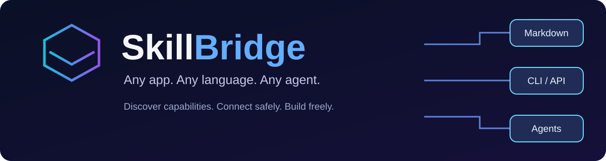

# SkillBridge

**Discover application capabilities without requiring every application to implement an agent protocol.** A small, language-neutral, local-first proof of concept.

> **Status: v0.1.0 MVP.** The working features are local Markdown/JSON discovery, permission-gated command execution, and an optional token-protected Python HTTP bridge. **Not yet implemented:** automatic scanning of installed apps, MCP/OpenAPI adapters, native Rust core/DLL, npx installer, sandboxed execution, or automatic LLM integration. This is not an MCP implementation.

## Install in seconds

Requires Python 3.10+ and Git. **The package is not published to PyPI yet.** After downloading or cloning this repository:

```bash
python -m pip install -e .
skillbridge discover examples/manifests
skillbridge inspect examples/manifests
```

For a clean virtual environment:

```bash
python -m venv .venv
# Windows PowerShell:
.venv\Scripts\Activate.ps1
# Linux/macOS:
# source .venv/bin/activate
python -m pip install -e .
```

## Zero-server discovery

Create `skillbridge.json` in any application folder:

```json
{
  "app": "TestApp",
  "skills": [
    {
      "name": "greet",
      "description": "Say hello to a user",
      "type": "command",
      "inputs": {"name": "string"},
      "argv": ["python", "hello.py", "{name}"]
    }
  ]
}
```

A compatible agent or tool runner can discover it with:

```bash
skillbridge discover ./testapp
```

Alternatively, create `SKILL.md` or `AGENT.md`. SkillBridge will read it as **documentation only**, not silently execute commands mentioned in Markdown.

### Call a command (requires explicit approval)

```bash
skillbridge call examples/manifests greet --args '{"name":"Forge"}' --allow-execute
```

On PowerShell, quoting JSON varies by shell. The CLI deliberately refuses execution without `--allow-execute`. Commands use argv arrays and `shell=False`, but this **does not sandbox** programs. Only run manifests you trust.

## Python: expose real functions

```python
from skillbridge import Bridge

bridge = Bridge("TestApp")
bridge.expose("greet", "Say hello", lambda name: f"Hi {name}", {"name": "string"})
bridge.serve()  # 127.0.0.1:8765, prints generated bearer token
```

Run `python examples/python/app.py`. A client with the token can then request:

```bash
curl -H "Authorization: Bearer YOUR_TOKEN" http://127.0.0.1:8765/manifest
curl -X POST http://127.0.0.1:8765/call -H "Authorization: Bearer YOUR_TOKEN" -H "Content-Type: application/json" -d '{"skill":"greet","args":{"name":"Forge"}}'
```

**Keep the token private.** The HTTP bridge is loopback-only, not production-hardened, and functions run with your application's permissions. Do not expose it to untrusted users.

## Examples in five languages

The same `skillbridge discover` JSON output can be consumed by any language. The examples demonstrate **CLI interoperability**, not native bindings or direct function exposure for every language.

| Language | Example | Run from directory |
| --- | --- | --- |
| Python | [`examples/python/app.py`](examples/python/app.py) | `python app.py` |
| TypeScript / Node.js | [`examples/typescript/demo.mjs`](examples/typescript/demo.mjs) | `node demo.mjs` |
| Go | [`examples/go/main.go`](examples/go/main.go) | `go run main.go` |
| Rust | [`examples/rust/main.rs`](examples/rust/main.rs) | `rustc main.rs -o demo && ./demo` |
| C++ | [`examples/cpp/main.cpp`](examples/cpp/main.cpp) | `g++ main.cpp -o demo && ./demo` |

Run the cross-language examples from their own folders after installing the CLI.

## Architecture

```text
Existing app -> skillbridge.json / SKILL.md
                          |
Agent / SDK -> discovery CLI -> JSON capabilities
                          |
                   explicit approval
                          |
                    argv execution

Python app -> Bridge.expose() -> local HTTP /manifest + /call
```

**Design direction:** add pluggable adapters for MCP, OpenAPI, HTTP and native ABI while retaining one capability schema. Discovery is read-only; execution is separately authorized. No LLM is required to test the bridge.

## Security boundaries

- Local discovery never runs a command.
- Commands require `--allow-execute` each invocation.
- Command inputs are type-checked; arguments are passed without a shell.
- The optional HTTP server binds to loopback and requires a bearer token.
- **No process isolation or sandbox exists in this MVP.** A malicious approved manifest can execute arbitrary programs. Inspect manifests before approving.
- Avoid exposing arbitrary SQL or filesystem operations. Design narrow, least-privilege skills.

## Test

```bash
python -m unittest discover -s tests -v
python -m build  # optional: first pip install build
```

## How to publish `pip install skillbridge`

`pip install skillbridge` only works after you publish a package with that exact name to [PyPI](https://pypi.org/). **Check name availability first**; this repository does not claim the name is available.

1. Create a PyPI account and configure trusted publishing (recommended) or an API token.
2. Update `name`, `version`, authors, and project metadata in `pyproject.toml`.
3. Run `python -m pip install build twine` then `python -m build`.
4. Validate with `python -m twine check dist/*` and publish with `python -m twine upload dist/*` (or use trusted publishing in CI).
5. After publication: `python -m pip install skillbridge`.

For a GitHub install **before** PyPI publication, replace `OWNER/REPO` with your actual GitHub path:

```bash
python -m pip install 'git+https://github.com/OWNER/REPO.git'
```

## Roadmap

- [x] Local JSON/Markdown discovery
- [x] CLI read-only inspection and opt-in execution
- [x] Python HTTP bridge with token auth
- [x] Cross-language CLI examples
- [ ] MCP/OpenAPI discovery adapters
- [ ] Signed manifests and explicit permission scopes
- [ ] Sandboxed execution via isolated processes / WASM
- [ ] Native Rust core with C ABI (.dll/.so/.dylib)
- [ ] npm/npx convenience CLI
- [ ] Auto-discovery and Forge integration

## Contributing

Issues and pull requests welcome. Please include a reproducible example and tests for behavior changes. See [LICENSE](LICENSE) (MIT).
